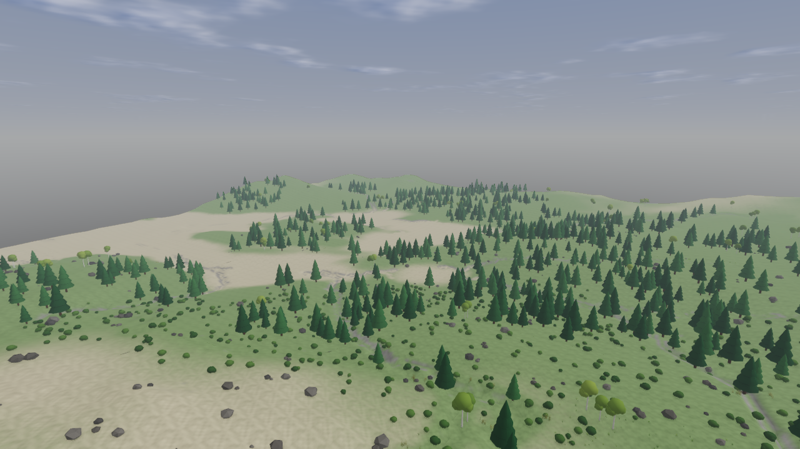
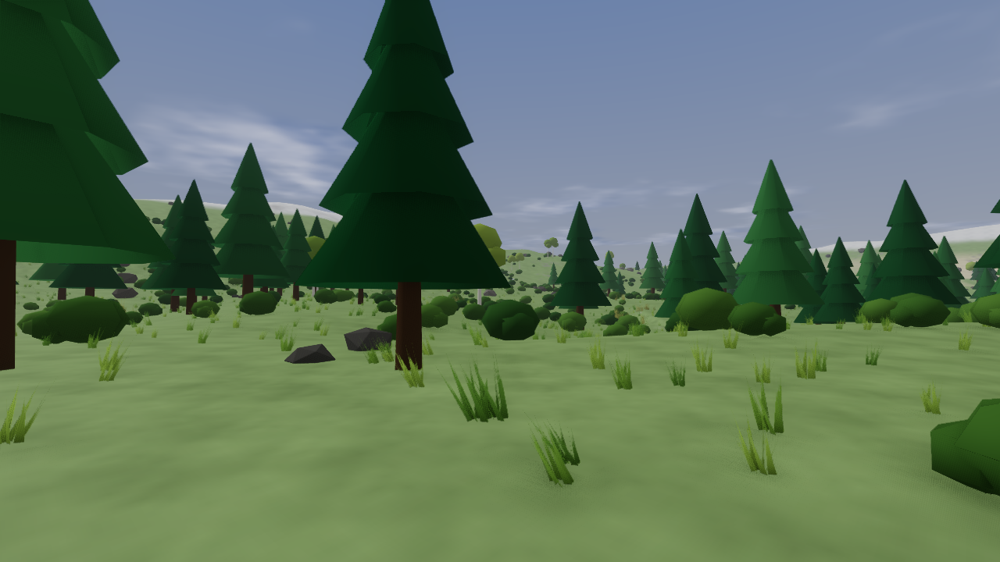
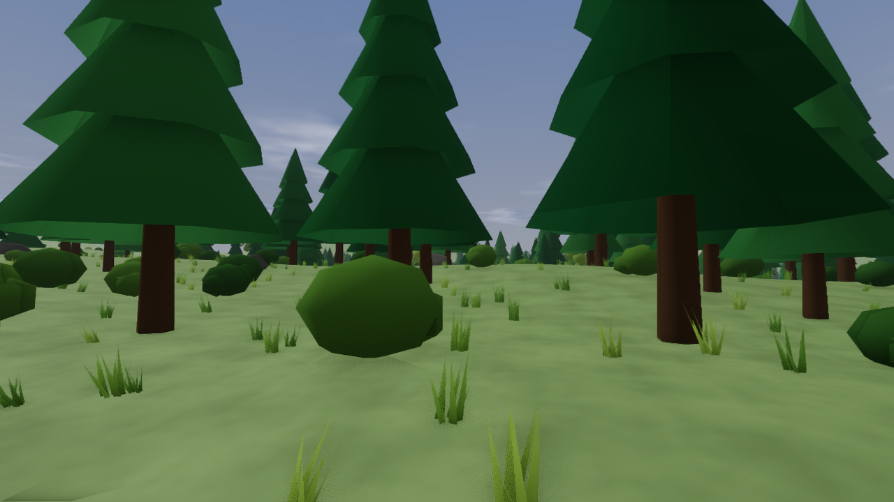

# Forest Valley: the Aether integrated showcase

Status: **Phase 1 in progress.** Every number in the tables below is a target, not a measurement of the current engine. The
measured facts so far are in "Phase 1 findings" at the end. The first step that is still open is measuring the existing
renderer (Phase 4, pulled forward to Phase 1).

Forest Valley is a 512 x 512 m explorable 3D environment with a controllable character. It exists to validate the
engine as an integrated whole (rendering, physics, destruction, audio, editor, packaging), not to be a game. It adds no
quests, inventory, combat or multiplayer.

## Specification

| Item | Target |
| --- | --- |
| World size | 512 x 512 m, five areas, walkable in 5-10 minutes |
| Performance | 1080p, 60 FPS on a named midrange GPU |
| Primary platform | Windows / D3D12 |
| Secondary validation | Linux / Vulkan |

## Areas

| Area | Content | Tests |
| --- | --- | --- |
| A. Starting Meadow | Spawn, grass, flowers, cabin, ambient audio, valley view | Vegetation, character movement, lighting, shadows |
| B. Ancient Woodland | Dense trees, ferns, moss, rocks, logs | Instancing, culling, LOD, streaming, frame-time stability |
| C. River and Waterfall | Water, shoreline, bridge, waterfall, mist | Reflections, transparency, particles, water shader, audio |
| D. Ancient Ruins | Stone architecture, doors, breakables | PBR, collision, physics, destruction |
| E. Mountain Overlook | Elevated viewpoint over the valley | Long-distance visibility, LOD, atmosphere, streaming |

## Rendering priorities

| System | Requirement | Priority |
| --- | --- | --- |
| PBR materials | Rock, wood, soil, vegetation, metal | P0 |
| Directional light | Sun and cascaded shadows | P0 |
| Atmosphere | Fog, sky, distance haze | P0 |
| HDR and tone mapping | Consistent indoor/outdoor exposure | P0 |
| Vegetation | Instanced trees, grass, foliage | P0 |
| Water | River surface and shoreline | P1 |
| Reflections | SSR with a defined fallback | P1 |
| Post-processing | Bloom, DOF, auto exposure | P1 |
| Hierarchical geometry | Cooker DAG, CPU reference validation | P1 |
| GPU cluster culling, geometry streaming | Later milestone | P2 |

P0 = first playable. P1 = polished. P2 = later rendering milestone.
**The first version reuses the existing renderer. The showcase must not depend on the unfinished cluster DAG.**

## Asset budget (planning quantities)

| Category | Instances |
| --- | --- |
| Trees | 800-1,500 |
| Grass and plants | 12,000-30,000 |
| Rocks | 500-1,000 |
| Logs and branches | 150-350 |
| Architecture and props | 100-250 |
| Interactive physics objects | 20-60 |

About 30-60 reusable source meshes, heavily instanced.

## Interactions and debug menu

Walk, run, jump, look, cross the bridge, open a door, push a physics object, trigger one destruction event. A debug
menu changes time of day, toggles effects, shows visible-object counts and captures performance measurements.

## Acceptance gates (proposed)

| Metric | Gate |
| --- | --- |
| CPU frame p95 | <= 16.67 ms |
| GPU frame p95 | <= 14 ms |
| Frame p99 | <= 20 ms |
| Soak | 30 minutes |
| Camera benchmark | Fixed, repeatable route |

Compare optimizations only on the same hardware, route and settings. Record results in `PERFORMANCE.md`, including
negative ones.

## Roadmap

1. **Foundation:** standalone showcase project (siblings: `samples/`, `games/`); terrain and reusable meshes; player
   camera and movement; Windows build and packaged launch. **Also capture the baseline renderer measurement here.**
2. **Environment:** populate five areas; terrain materials, vegetation, lighting; river, waterfall, fog; the camera route.
3. **Interactions:** Jolt collisions and props; destruction with safe debris limits; ambient audio and particles; debug
   graphics controls.
4. **Optimization:** profile CPU/GPU and streaming; integrate validated cluster LOD when ready; quality transitions and memory.
5. **Release verification:** full CTest; Windows/MSVC/D3D12 packaged build; Linux/Vulkan validation; screenshots,
   performance report, limitations.

## Deliverables

The 512 x 512 m environment, a packaged Windows build, a repeatable benchmark, consistent-settings screenshots, a
CPU/GPU profiling report, automated scene and rendering regression tests, and documentation of verified capabilities,
limitations and remaining work.

## Existing modules to build on

`terrain/`, `timeofday/`, `vfx/`, `streaming/`, `physics/`, `destruction/`, `audio/`, `player/`, `sequencer/` (camera
route). Check each against the showcase needs before assuming coverage; gaps found become the work list.

## Open questions

- Which GPU is the "midrange" reference?
- Does the cluster/hierarchy work in draft PR #989 land before Phase 4, or does the showcase run on the old path first?
- Where do source meshes come from (authored, glTF import, procedural), and under what license?

## Phase 1 findings

`samples/forest_valley` is the portable, headless core: the generated valley, the five areas, the walkable route, an
on-foot controller, the benchmark camera path and the gate arithmetic. `tests/test_forest_valley.cpp` covers it (10
tests, passing on Linux/GCC in a standalone build; the full `aether_tests` link needs the windowing backend).

Measured, not assumed:

- **The generator's defaults cannot make this world.** At the defaults the 513 x 513 map is 46% water and only 21% of it
  is walkable in its largest piece, so no route crosses it. A low sea (`sea_level` 0.04), gentler ridges
  (`ridge_amount` 0.3), `frequency` 2.0 and `river_min_catchment` 1500 give about 85% walkable ground in one piece.
- **Areas are chosen by rule and must lie on the main walkable landmass.** The overlook is picked first (highest flat
  standing place), then the meadow (lowest wide flat ground). Picking the meadow first put it on the high plateau, above
  the overlook.
- **Route: 1,267 m, 6.0 minutes at 3.5 m/s walking pace**, inside the 5-10 minute target. Rivers are wadeable; the
  bridge is Phase 2 art, not yet a collision or navigation feature.
- **Scatter within the asset budget:** 1,181 trees, 30,000 plants (the cap; grass is the limit), 805 rocks. The default
  boulder density gave 62 rocks, so the showcase rule raises it.

- **The valley is chunked terrain the renderer can take.** `valley_terrain.h` builds 16 x 16 chunks (33 vertices a side),
  a 512 x 512 four-layer splatmap (grass, rock, sand, snow) and the layer colours. `PlanTerrainFrame` runs the real
  `TerrainRenderer` against a counting GPU: from the meadow it keeps all 256 chunks resident at 47,360 triangles and
  1.4 MB (10 chunks at LOD 0, 144 at LOD 3), against 524,288 triangles with every chunk at full detail. That is a CPU
  count of meshes, not a GPU timing.
- **The first meadow was a beach.** Picking the lowest flat ground put the spawn on the beach band, 98% sand in the
  splatmap. The meadow must now be grass or forest floor 5 m above the sea; its splatmap texel is pure grass.

### The terrain is drawn

A scene now carries a `ProceduralTerrain` component (generator settings, no heightmap), and `aether_player` draws the first one
in the world: `SceneRenderer` builds a `TerrainView` (`player/src/terrain_view.h`) that generates the ground, uploads 16 x 16
chunks and the splatmap, and records them inside the scene pass after the sky and before the models. `ValleyTerrainComponent()`
holds the one set of settings; a test regenerates the ground from the component and compares it to the world the areas and
route were built on. `samples/forest_valley/ForestValley.aproject` and `Content/Scenes/` (written by `tools/make_scenes.py`)
are the project.

Reproduce the screenshots (Linux, Mesa's lavapipe; on Windows run the packaged player instead):

    aether_cook samples/forest_valley/ForestValley.aproject --out paks --config development
    VK_ICD_FILENAMES=/usr/share/vulkan/icd.d/lvp_icd.json xvfb-run -a aether_player --pak paks \
        --scene Scenes/Valley.ascene --backend vulkan --frames 12 --size 1280x720 --screenshot valley.bmp

Measured on this run (software Vulkan, `RelWithDebInfo`; not a GPU number): the 513 x 513 terrain generates and uploads in
0.8-0.9 s (256 chunks, 14.9 MB), and the plants add about 0.13 s: 31,986 of them (1,050 pines, 131 birches, 4,500 shrubs,
24,000 grass tufts, 1,500 reed clumps, 805 boulders) in 978 merged meshes and 38.7 MB. The frame rate on lavapipe says
nothing about a real GPU and is not recorded.

### Vegetation is drawn

`ProceduralTerrain::vegetation` scatters plants over the ground by the terrain module's rules (pines and birches on forest
slopes, shrubs in the gaps, grass between, boulders in clumps, reeds at the water). The counts follow the asset budget above
(`MakeVegetationRules`: 1,500 trees, 30,000 plants, 1,000 rocks at density 1, times `vegetation_density`), and the test that
checks the budget uses the same function the player does.

The RHI has no instanced draw, so the plants are **statically batched**: every plant of one kind in one 32 m chunk is merged
into one mesh on the CPU (`vegetation_batch.h`) and drawn with the ordinary indexed draw (`vegetation_pass.h`), culled by
the view frustum and by a distance per kind (grass 80 m, reeds 120, shrubs 170, boulders 300, trees 450). Adding an instanced
draw to both backends would cut the memory but is a bigger change and could not be checked on D3D12 here. A vertex shader
sways what bends in the wind (tips most, trunks and rocks not at all).

What the plants honestly are: **placeholder procedural shapes**, not art. A pine is a trunk and four cones, a birch a trunk
and three blobs, grass a fan of seven triangles, a boulder a faceted icosahedron, each with one flat palette colour (three
shades a kind, picked from where the plant stands). The scene reads as a low-poly forest, not a photographic one.

What the screenshots honestly show: ground, plants, sky, clouds and haze. Specifically:

- **The spawn "meadow" is a pine stand.** The meadow rule accepts forest floor as well as grassland, and nothing keeps plants
  clear of the spawn point, so the player starts among trees. Nothing collides with the plants yet.
- **Woodland is sparse.** The budget is 1,181 trees over 512 x 512 m, about one a 220 m^2; "dense woodland" needs a higher
  density, which the budget would have to allow.
- **Grass pops in and out** at its 80 m limit; there is no fade.
- **Nothing here casts or receives sun shadows**, plants included, and the terrain is not in the water reflection.
- **The layer textures are 64 x 64 generated placeholders**, tiled every 4-8 m, so close ground is blurry.
- **Rivers are grey scratches, not water**: there is no water surface, and no bridge.
- **No flowers, logs, ferns or buildings** (the plan's meadow and woodland call for them); no ruins, props or interactables.
- **The sun is only the first DirectionalLight's direction and brightness**, not its colour.
- The generation and scatter run on the frame a scene first shows the terrain, so that frame stalls for about a second.

Not done in Phase 1 so far, and not claimed:

- The Windows build, D3D12 drawing and packaged launch are unverified (this environment is Linux; the HDR path of the terrain
  shader is exercised here through Vulkan only).
- No performance baseline has been taken: that needs a real GPU.
