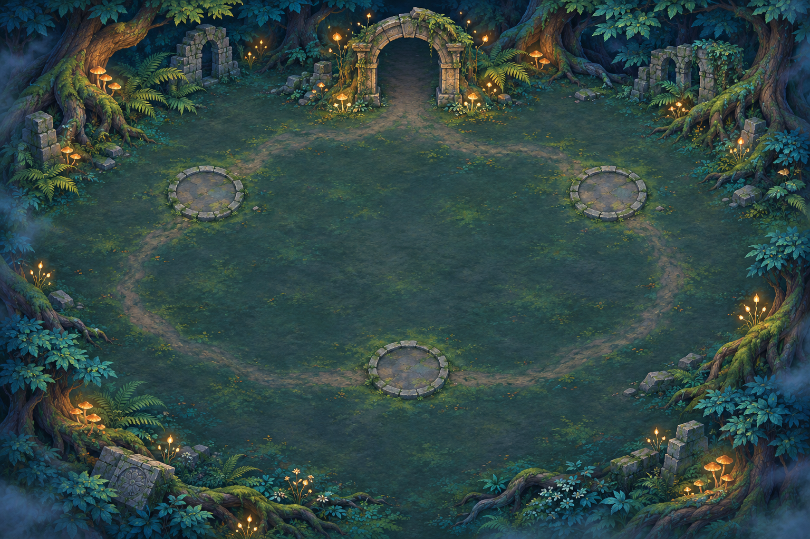

# Lanternwake

**Some things only need a little light.**

A complete, compact overhead adventure made with Aether. Gather twelve embers
in a painted forest, offer four to each of three sleeping shrines, and return
through the northern arch. Six wandering shades stalk the grove. Your lantern
repels them; a quick dash slips past danger. Five hits extinguish your light.

The game includes original painted art, warm lighting, fireflies and particles,
a complete title/pause/victory/defeat flow, a musical ambience, and event sounds.
There is no time limit. A fast route takes under a minute; a first journey gives
you room to explore and learn the abilities. A score rewards speed and health.



## Play

The browser export is a **single `index.html` file**. Download it and open it in
a recent desktop browser. It embeds the WebAssembly runtime, art, and fonts;
it needs no server, installation, account, or network connection after download.
Click **Enter the grove** or press **Enter**. Click the game if keys do not respond.

| Control | Action |
|---|---|
| WASD or arrow keys | Move |
| Space | Dash in the movement/last facing direction |
| F or left mouse | Lantern pulse: repel and briefly stun nearby shades |
| Hold E | Offer four embers at a sleeping shrine |
| E at the northern arch | Finish after all three shrines are lit |
| Escape | Pause / resume |
| R | New journey from the pause or result screen |
| M | Mute / unmute |

Offering takes 0.8 seconds without moving or being hit. Interrupted offerings
do not spend embers. Pulses use energy, which regenerates. Dashes have a short
cooldown and protect you from contact damage. After the third offering the
shades become harmless, giving you a clear walk home. Leaving the window pauses
the game; returning leaves it paused until you choose to continue.

## What runs on Aether

This is native C++ gameplay using the actual source from this checkout:

| Responsibility | Aether implementation |
|---|---|
| All gameplay entities and components | `World`, archetypes, entity handles and queries |
| PNG loading | `assets::DecodeImageFile` and the engine's stb integration |
| Fonts, glyph layout and SDF coverage | `ui::SdfFont`, `ui::DrawList`, `ui::SdfCoverage` |
| Sound data | `audio::SoundWave` |
| Frame capture | `assets::EncodePngRgba8` |

The game owns its fixed-step rules and a software pixel compositor, following
the architecture of Aether's small playable samples. SDL supplies the window,
input, frame upload and audio device. The browser build compiles **these same
C++ sources** with Emscripten; gameplay is not reimplemented in JavaScript.

This game uses a painted 2D presentation. It does not exercise Aether's Vulkan
or Direct3D PBR renderer, scene cooker, or editor project format. There is no
`.aproject` file pretending to load a different runtime.

## Build the native game

Requires Git, CMake 3.21+, a C++20 compiler, and SDL2. The bootstrap fetches
official, pinned SDL2 and stb sources into the ignored `build/deps` directory.
An installed SDL2 is preferred; CMake can build SDL2 from source otherwise.

From the engine repository root on Linux/macOS, or Git Bash on Windows:

```sh
bash games/LANTERNWAKE/tools/build_native.sh
ctest --test-dir build-lanternwake --output-on-failure
./build-lanternwake/lanternwake
```

On a multi-configuration Windows build, the executable is normally
`build-lanternwake/Release/lanternwake.exe`. Use `ctest -C Release` there.
The assets are copied beside the executable, including after asset-only edits.

To include it in an existing full Aether build:

```sh
bash games/LANTERNWAKE/tools/bootstrap_deps.sh
cmake -S . -B build -DAETHER_BUILD_LANTERNWAKE=ON
cmake --build build --config Release --target lanternwake
```

The option defaults to off so ordinary engine builds do not need SDL or the art.
The standalone build compiles the exact engine modules listed above, directly
from this repository. The full integration links `Aether::Engine`, `Aether::UI`
and `Aether::Audio`.

## Build the browser game

Activate Emscripten (verified with 4.0.21), or set `EMSDK` to its installation:

```sh
bash games/LANTERNWAKE/tools/build_web.sh
```

The result is `build-lanternwake-web/index.html`. `--embed-file` and
`SINGLE_FILE=1` keep all dependencies in that file. The default browser export
targets desktop keyboard/mouse play; touch controls are not implemented.

## Headless captures and repeatable play

```sh
./build-lanternwake/lanternwake --headless --screenshot title.png
./build-lanternwake/lanternwake --headless --scene play --frames 120 --screenshot play.png
./build-lanternwake/lanternwake --headless --autoplay --frames 1800 --screenshot ending.png
./build-lanternwake/lanternwake --assets /path/to/assets --window 1280x800
```

The autoplay controller supplies ordinary movement and ability inputs to the
real simulation. It does not teleport the keeper, grant items, or bypass damage.
Game tests additionally cover exact resource accounting, interrupted offerings,
normalization, cooldowns, pause, damage, terminal states and deterministic replay.

## Assets and known scope

See [assets/ART.md](assets/ART.md) for original generated-art provenance and
the source prompts. PNG alpha is preserved; import crops transparent margins
and filters in premultiplied color to avoid dark fringes. Restored shrines and
characters share ground-Y depth ordering. The music and effects are an original
synthesized composition in `src/audio.cpp`. Fonts and dependency notices are
included in `assets/LICENSE-*`.

This first version has one fixed grove and one complete objective chain.
Characters use painted sprites with procedural movement, bobbing and effects,
rather than frame-by-frame skeletal animation. Progress is for the current
journey; there is no save system. Windows/macOS have portable build paths, but
only the execution platforms explicitly recorded in [VALIDATION.md](VALIDATION.md)
are claimed as tested.
